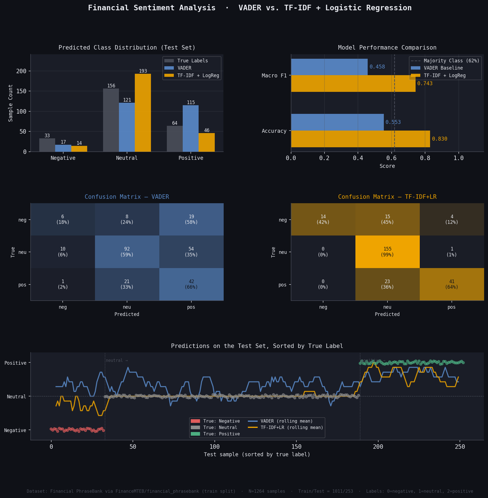

# Financial Sentiment Analysis

**Does a general-purpose sentiment tool read financial news correctly?** This project compares VADER, a dictionary-based sentiment model used far beyond its original domain, with a TF-IDF + logistic regression classifier trained on labeled financial sentences.

- **Live demo:** https://emilohligs.github.io/Financial-Sentiment-Analysis/demo/ — type a sentence and watch both models disagree. Runs in your browser.
- **Project page:** https://www.thinkbeyondai.com/projects/financial-sentiment-analysis/
- **Related video:** https://www.youtube.com/watch?v=0C4p-D8-Tv8&t=165s



## Results

<!-- results:start -->
*Run `python scripts/evaluate_and_export.py` to fill this block.*
<!-- results:end -->

Every number about this project, in this README and elsewhere, comes from [`results.json`](results.json), which the script above writes.

## Why VADER struggles here

VADER scores each word against a general-purpose dictionary and adjusts for negation, intensifiers and punctuation. That works for product reviews and social media. Financial language breaks it in two ways:

- **Domain words are missing.** *Headwinds*, *writedown*, *impairment*, *downgrade* and *bankruptcy* are not in VADER's dictionary at all, so they count as neutral.
- **General sentiment words mislead.** In *"The group faces significant headwinds"*, VADER only finds *significant*, which it scores as positive, and labels the sentence positive.

A classifier trained on financial text learns which terms move sentiment in this domain, but only for terms it has seen.

## Method

**VADER** (Hutto & Gilbert, 2014), rule-based, no training. The compound score is mapped to a label with the authors' thresholds:

```
compound ≥  0.05  →  positive
compound ≤ −0.05  →  negative
otherwise         →  neutral
```

**TF-IDF + logistic regression**, supervised:

- TF-IDF with unigrams and bigrams (`ngram_range=(1, 2)`, so *net loss* and *operating profit* count as units), `max_features=5000`, `sublinear_tf=True`, no stemming
- multinomial logistic regression, `C=1.0`, `lbfgs`

```
TF-IDF(t, d) = TF(t, d) · IDF(t)
P(y = k | x) = exp(w_k · x) / Σ_j exp(w_j · x)
```

**Evaluation:** one stratified random 80/20 split (`random_state=42`). Accuracy and macro-F1, since the classes are imbalanced, plus per-class recall and a majority-class baseline.

## Data

Financial PhraseBank (Malo et al., 2014): sentences from English financial news, each labeled negative, neutral or positive by several annotators with background knowledge of financial markets. This project loads the train split published as `FinanceMTEB/financial_phrasebank` on Hugging Face; `results.json` records the exact URL, sentence count, label distribution and a SHA-256 of the loaded data.

Without network access, set `USE_HUGGINGFACE = False` in `financial_sentiment_model.py` to use a small embedded sample (63 sentences). That mode is for development only; its numbers are not meaningful.

## Reproduce

```bash
pip install -r requirements.txt
python -c "import nltk; nltk.download('vader_lexicon')"

python scripts/evaluate_and_export.py   # results.json, README results, docs/demo/model.json
python run_sentiment_dashboard.py       # financial_sentiment_dashboard.png
```

## The demo

`docs/demo/` is a static page served with GitHub Pages. `models.js` contains a line-by-line JavaScript port of NLTK's VADER and a scorer for the exported TF-IDF + logistic regression model:

- **VADER:** the port returns the same compound score as NLTK 3.10 on 92 test sentences, including negation, capitalization, *but* clauses, punctuation and idioms.
- **Logistic regression:** `scripts/evaluate_and_export.py` re-scores the whole test set from `model.json` and stops if a single label differs from scikit-learn.

Nothing typed into the demo leaves the browser.

## Limitations

- **One random split, no cross-validation.** The numbers carry sampling noise.
- **No time-based split.** Sentences are shuffled. A production model would be trained on older and tested on newer text.
- **Bag of words.** TF-IDF does not see word order beyond bigrams. *"Net loss narrowed"* contains an improvement that neither model is built to recognize.
- **Not the state of the art.** Transformer models fine-tuned on financial text, such as FinBERT, report clearly higher scores on this dataset. This project compares two transparent baselines; it does not compete with them.

## Repository

```
financial_sentiment_model.py   models, data loading, evaluation (importable, no side effects)
run_sentiment_dashboard.py     four-panel dashboard
scripts/evaluate_and_export.py results.json, README results, demo model
docs/demo/                     in-browser demo (GitHub Pages)
Vader_demo/vader_demo.py       VADER failing on a single sentence, step by step
```

## References

- Hutto, C. J., & Gilbert, E. (2014). *VADER: A Parsimonious Rule-based Model for Sentiment Analysis of Social Media Text.* ICWSM.
- Malo, P., Sinha, A., Korhonen, P., Wallenius, J., & Takala, P. (2014). *Good debt or bad debt: Detecting semantic orientations in economic texts.* Journal of the Association for Information Science and Technology, 65(4).

## License

- **Code:** MIT, see [LICENSE](LICENSE).
- **`docs/demo/model.json`:** the classifier weights are derived from the Financial PhraseBank and are shared under its license, CC BY-NC-SA 3.0 (non-commercial, share-alike). The VADER lexicon inside the same file is MIT-licensed.
